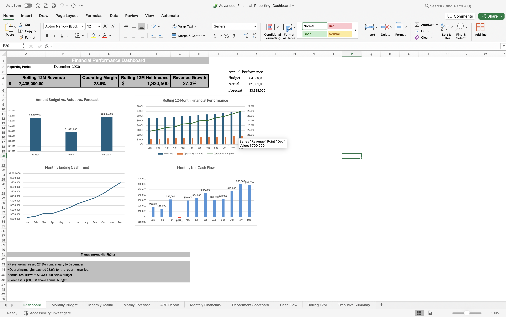

# Advanced Financial Reporting & Executive Dashboard

## Project Overview

This Excel-based portfolio project demonstrates advanced financial
analysis, management reporting, and dashboard development. The workbook
combines budget, actual, forecast, cash flow, departmental performance,
and rolling 12-month reporting into an executive-level financial
reporting package.

The financial data used in this project is sample/fictional data created
for portfolio and skills-demonstration purposes.

## Workbook Components

### Executive Dashboard

-   Executive KPI cards for Rolling 12M Revenue, Operating Margin, Net
    Income, and Revenue Growth
-   Annual Budget vs. Actual vs. Forecast comparison
-   Rolling 12-month financial performance visualization
-   Monthly ending cash trend
-   Monthly net cash flow analysis
-   Dynamic management highlights

### Executive Summary

-   Key financial metrics
-   Budget, Actual, and Forecast comparison
-   Unfavorable variance highlighting
-   Formula-driven management commentary

### Actual vs. Budget vs. Forecast Analysis

-   Monthly Actual, Budget, and Forecast comparison
-   Dollar variance analysis
-   Percentage variance analysis
-   Visual performance comparison

### Rolling 12-Month Reporting

-   Dynamic reporting-period control
-   Rolling 12M Revenue
-   Operating Expenses
-   Operating Income
-   Operating Margin
-   Net Income
-   Revenue and Operating Income growth analysis
-   Financial performance and Net Income trend charts

### Cash Flow Reporting

-   Monthly beginning and ending cash roll-forward
-   Operating cash flow
-   Capital expenditures and debt payments
-   Monthly and full-year net cash flow
-   Monthly ending cash trend
-   Negative cash-flow identification
-   Dynamic strongest and weakest cash-flow month analysis

### Department Scorecard

-   Department-level Budget vs. Actual analysis
-   Dollar and percentage variances
-   Conditional formatting for favorable and unfavorable performance
-   Highest and lowest variance department identification

### Supporting Financial Data

-   Monthly Financials
-   Monthly Budget
-   Monthly Actual
-   Monthly Forecast

## Excel Skills Demonstrated

-   SUMIFS
-   XLOOKUP
-   INDEX / MATCH
-   MAX and MIN
-   TEXT
-   EOMONTH
-   Relative and absolute cell references
-   Cross-worksheet formulas
-   Dynamic reporting formulas
-   Accounting and percentage number formats
-   Conditional formatting
-   KPI card design
-   Line, column, and combination charts
-   Secondary chart axes
-   Executive dashboard layout
-   Financial statement formatting
-   Management reporting and variance analysis

## Key Financial Reporting Concepts

-   Budget vs. Actual vs. Forecast analysis
-   Rolling 12-month reporting
-   Operating margin analysis
-   Revenue and operating income growth
-   Cash-flow forecasting and reconciliation
-   Department performance measurement
-   Executive-level financial reporting

## Portfolio Files

-   `Advanced_Financial_Reporting_Dashboard.xlsx` --- Complete Excel
    financial reporting workbook
-   `README.md` --- Project documentation
-   Dashboard screenshot --- Visual preview of the finished executive
    dashboard

## Purpose

This project was created to demonstrate practical Excel, FP&A, financial
systems, and management-reporting skills in a realistic business
reporting environment.
